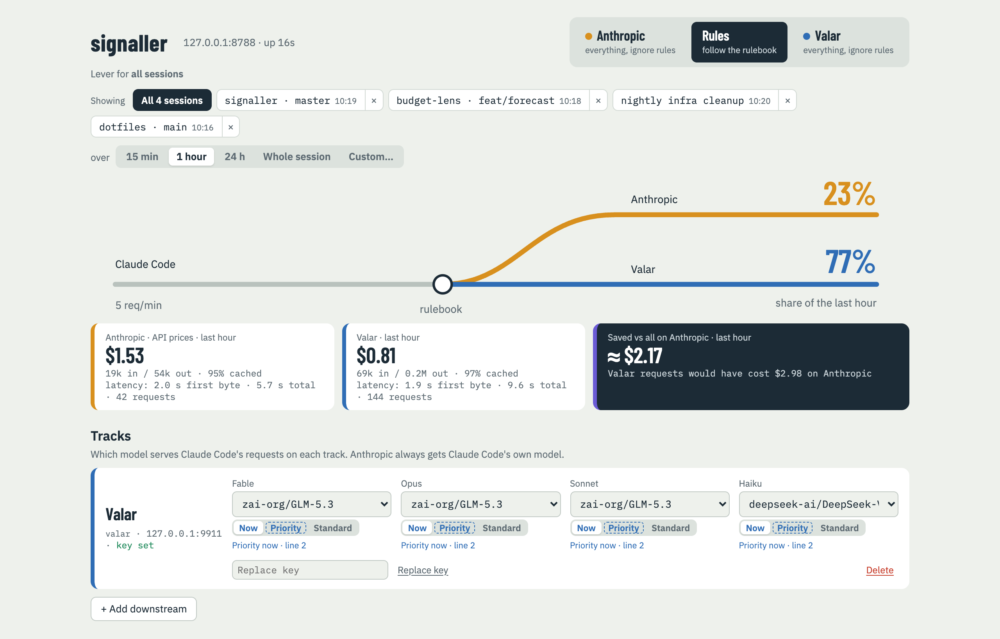
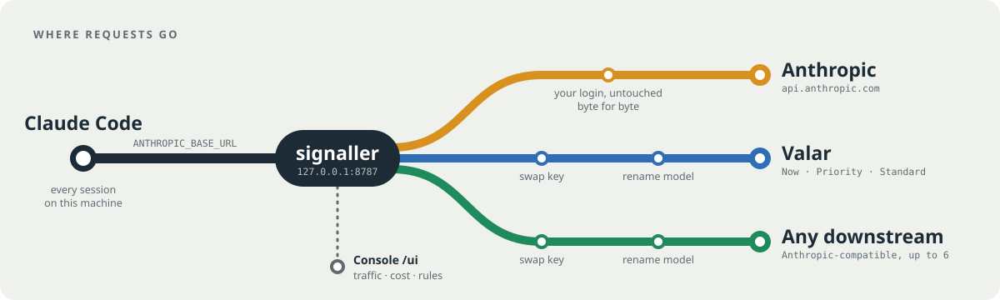
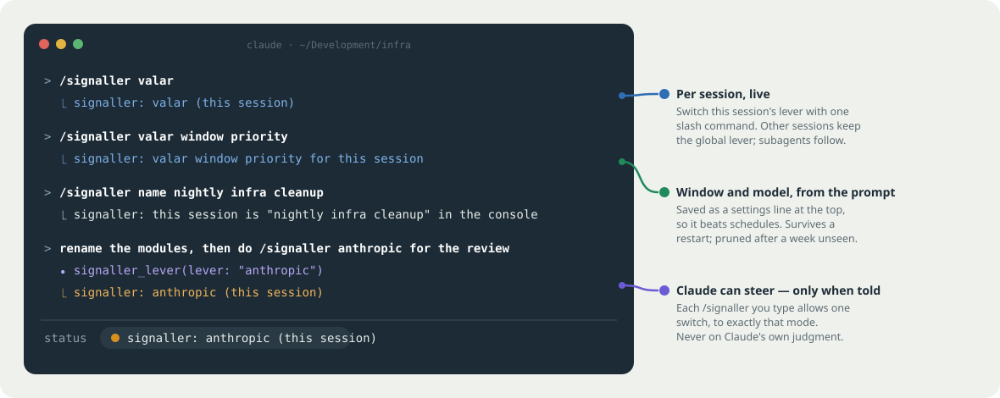
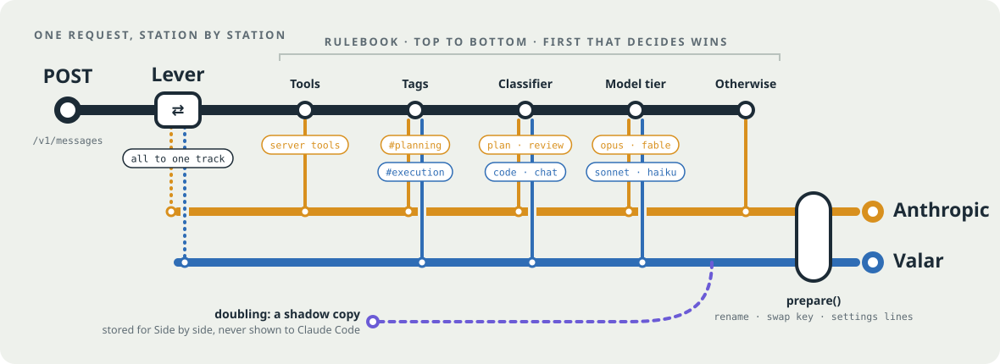
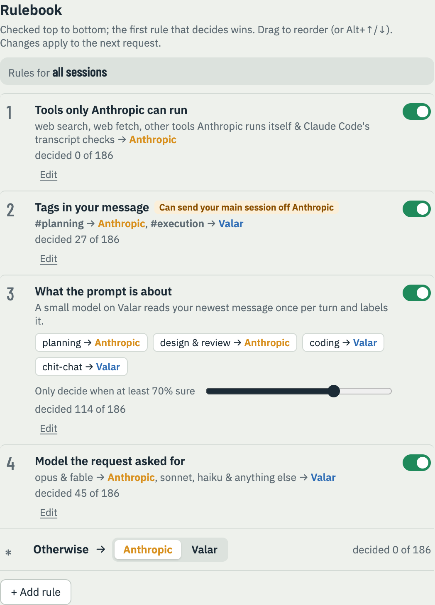
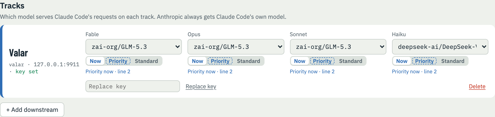
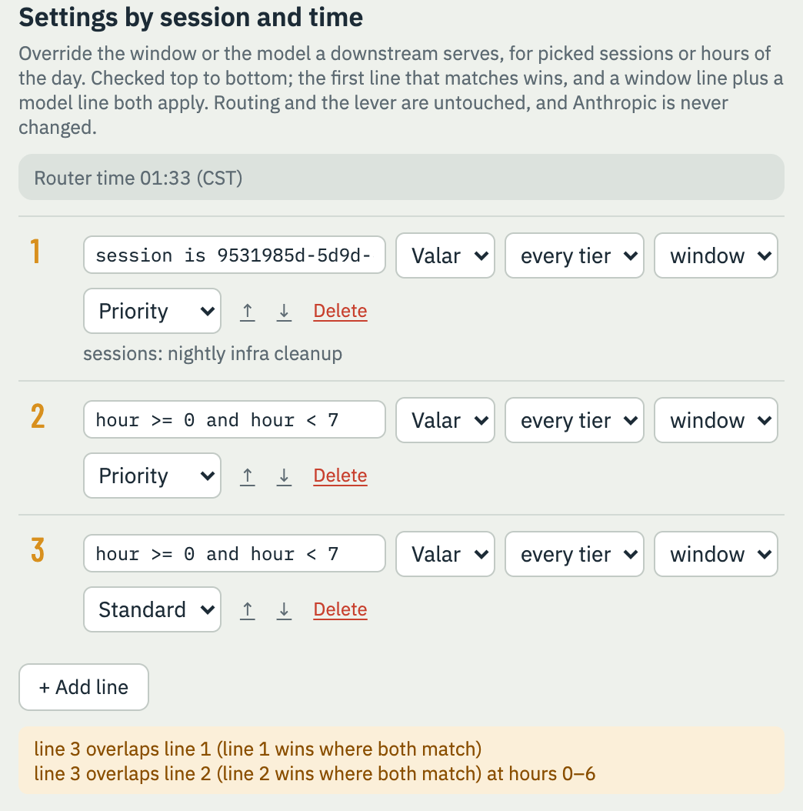
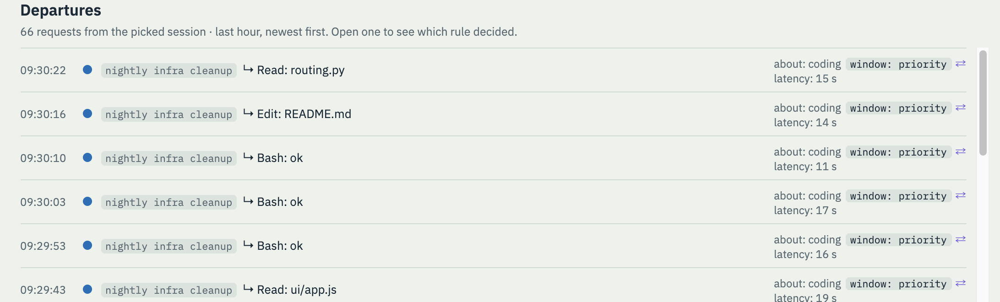
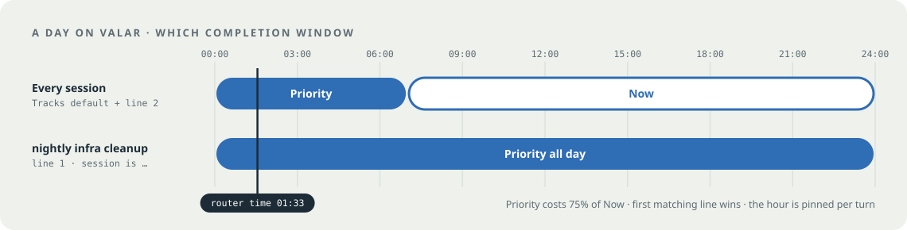

<div align="center">

# Signaller

**Keep the thinking on Anthropic. Send the typing somewhere cheaper.**

A loopback proxy for Claude Code that decides, request by request, which model
answers — and shows you what it saved.

`Python 3 stdlib only` · `no dependencies` · `loopback only` · `keys never leave one 0600 file` · `MIT`

<sub>Unofficial · not affiliated with Anthropic or Valar · runs locally with your own accounts — see <a href="#terms-and-disclaimer">Terms and disclaimer</a></sub>



</div>

## What it does

signaller sits at Claude Code's `ANTHROPIC_BASE_URL`. Each request goes
either to **Anthropic** (untouched, on your own login) or to a **downstream**:
any Anthropic-compatible service you add in the console. On a downstream the
router swaps in that service's key and renames the model. A console at `/ui`
shows live traffic and cost, and it is where you edit the rules and manage
downstreams.

<p align="center"></p>

| | |
|---|---|
| 🎚️ **One lever, steerable from the prompt** | Anthropic, Rules, or one downstream — globally from the console, or per session with `/signaller` without leaving Claude Code. |
| 📜 **A readable rulebook** | `when tier is opus go anthropic`. Tags, model tier, prompt size, or a classifier's guess at what the prompt is about. |
| 🕐 **Settings by session and time** | "Background sessions and 00:00–07:00 use Valar's cheaper Priority window." |
| 💸 **Cost you can see** | What each track cost, what the same traffic would cost on the Anthropic API, and the difference. |
| 🪞 **Side by side** | Double a share of turns to a second track and judge the answers. |
| 🛟 **Never fails closed** | A bad config, broken stats or a slow classifier falls back with a banner; routing carries on. |

## Steer it from inside Claude Code

The **signaller** plugin puts the router in your prompt. `/signaller` answers
instantly without a model turn, the status line always shows where this
session is going, and nothing you change here touches your other sessions.

<p align="center"></p>

```
/plugin install signaller --marketplace openconductorhq/signaller
```

| You type | It does |
|---|---|
| `/signaller valar` · `/signaller anthropic` · `/signaller rules` | Switch **this session** (and its subagents); `/signaller reset` goes back to the global lever. |
| `/signaller valar window priority` | This session's Valar window, saved as a settings line that beats schedules. |
| `/signaller valar sonnet model glm-4.8` | The model this session gets for a tier on that downstream. |
| `/signaller name nightly infra cleanup` | How the session shows in the console. |
| `/signaller run execute` | Puts a prompt you saved in the console in the prompt box; Enter sends it as yours. |
| "…then do `/signaller anthropic` for the review" | Claude may switch, once, to exactly what you typed. |

Full reference: [`/signaller` in Claude Code](#signaller-in-claude-code).

### What happens to one request

<p align="center"></p>

## Install

### In a container (recommended)

```
git clone git@github.com:openconductorhq/signaller.git && cd signaller
mkdir -p ~/.config/signaller
cp env.example ~/.config/signaller/env
chmod 600 ~/.config/signaller/env      # set VALAR_API_KEY here if you use Valar (read once, see Downstreams)
docker compose up -d --build
```

- **Network:** `compose.yaml` publishes the router on `127.0.0.1:8787` only.
  Inside the container it listens on `0.0.0.0`, which the router allows only
  with `SIGNALLER_IN_CONTAINER=1` (set by the image).
- **Files:** config lives in `~/.config/signaller`. Stats live in the
  `signaller_stats` Docker volume, not in that folder (see [Data](#data)).
- **Session labels:** `~/.claude/projects` is mounted read-only to label
  sessions.
- **User:** the image runs as uid 1000. On Linux, if your uid differs, add
  `user: "<uid>:<gid>"` to the service.

To rebuild after pulling changes, run `docker compose up -d --build`. Logs:
`docker compose logs -f`.

### As a systemd user service

```
mkdir -p ~/.config/signaller
cp env.example ~/.config/signaller/env
chmod 600 ~/.config/signaller/env
mkdir -p ~/.config/systemd/user
ln -s $PWD/signaller.service ~/.config/systemd/user/
systemctl --user enable --now signaller
```

The unit runs Python with `-E -s`, which ignores `PYTHON*` env vars and the user
site directory, so only the standard library is ever loaded. Logs:
`journalctl --user -u signaller -f`.

### Moving from claude-router

Signaller was called claude-router. Its folder, variables and volume were
renamed, so an existing install moves over once. Run this from the new
checkout; it stops the router for a moment and keeps your stats:

```
docker compose -p claude-router down                       # stop the old project
mv ~/.config/claude-router ~/.config/signaller
sed -i '' 's/^CLAUDE_ROUTER_/SIGNALLER_/' ~/.config/signaller/env   # GNU sed: -i without ''
docker compose build && docker compose create              # creates signaller_stats, doesn't start
docker run --rm --user 0 -v claude-router_stats:/from -v signaller_stats:/to signaller sh -c 'cp -a /from/. /to/'
docker compose start
```

In Claude Code, swap the plugin: `/plugin uninstall router-lever`,
`/plugin marketplace remove claude-router`, then install as below. Once the
console shows your history, `docker volume rm claude-router_stats`.

### Turn it on in Claude Code

Add this to `~/.claude/settings.json`:

```json
"env": {"ANTHROPIC_BASE_URL": "http://127.0.0.1:8787"}
```

- **Bypass for one session:** `ANTHROPIC_BASE_URL= claude`
- **Router down:** every Claude Code session fails to connect. Use the bypass,
  or restart the router.

### Environment

These are read from `~/.config/signaller/env`; `env.example` lists them.

| Variable | Default | Meaning |
|----------|---------|---------|
| `SIGNALLER_LISTEN` | `127.0.0.1:8787` | Must be a loopback address, or the router exits with code 2 (outside a container). |
| `SIGNALLER_ANTHROPIC_URL` | `https://api.anthropic.com` | Where the Anthropic track goes. |
| `SIGNALLER_CONFIG_DIR` | `~/.config/signaller` | Config files (see [Data](#data)). |
| `SIGNALLER_STATS_DIR` | the config dir | Where `stats.db` lives. The image sets it to `/data` (the `signaller_stats` volume). |
| `VALAR_URL`, `VALAR_API_KEY` | `https://api.valarhq.ai` | Used once, to seed the Valar downstream. |
| `TZ` | the host's zone | The router's local time: the settings lines' `hour` field and the console clock. In the container set it to an IANA zone (`TZ=Asia/Jerusalem`); the host's `/etc/localtime` isn't shared into the VM under Colima, and an empty or unset `TZ` means UTC. |

`LITELLM_*`, `SIGNALLER_LOCAL_SONNET` and `SIGNALLER_LOCAL_HAIKU` are no
longer used. To keep using LiteLLM, add it as a downstream.

## `/signaller` in Claude Code

The `signaller` plugin (in `plugin/`) adds `/signaller`. It answers without a
model turn, and the status line shows `signaller: <mode> (this session|global)`,
plus `, session name: <name>` once you've named it. It refreshes as each turn
starts and ends, right after a `/signaller` command, and once a minute while
idle, so a change made in the console shows within a minute.

| Command | What it does |
|---------|--------------|
| `/signaller` | Show the mode. |
| `/signaller rules\|anthropic\|<downstream id>` | Switch this session only; its subagents follow. Other sessions keep the console's lever. |
| `/signaller reset` | Go back to the global lever. |
| `/signaller name <text>` | Name this session in the console. `/signaller name` alone clears the name. |
| `/signaller run <name>` | Put a prompt saved in the console (**Prompts**) in the prompt box. You can add to it, then Enter sends it as your own, so the `/signaller` steps in it count as typed. `/signaller run` alone lists them with their text. |
| `/signaller <downstream> [<tier>] window\|model <value>` | Set this session's own settings line on a downstream: its completion window (`/signaller valar window priority`) or the model it serves for a tier (`/signaller valar sonnet model glm-4.8`; without a tier, every tier). It goes in at the top of the settings list, so it beats schedules. |
| `/signaller <downstream> reset` | Clear this session's settings lines for that downstream. |

A session's own lever lives in the router's memory, so a router restart drops
it. Settings lines set with `/signaller` are saved in `console.json`, so they
survive a restart; a session id unseen for a week — including one the stats
no longer know at all — is dropped from them.

Claude can switch the lever too, through the plugin's `signaller_lever` tool, but
only when you typed `/signaller <mode>` in a message. That can be "do /signaller
anthropic", or a plan with "/signaller rules" at a later step. Each one you type
allows one switch to that mode, in the order you typed them; any other switch is
refused. Setting this session's window or model through the tool needs a typed
`/signaller <downstream> [<tier>] window|model <value>` the same way, in the same
queue. Messages you send while Claude works keep the queue; a new message with
any `/signaller` in it replaces it. Only the main agent can switch: a subagent's
call is refused (subagents follow their session anyway).

The plugin talks to `127.0.0.1:8787` only. Install:

```
/plugin install signaller --marketplace openconductorhq/signaller
```

## Routing

Routing applies to `POST /v1/messages` and `/v1/messages/count_tokens`.
Everything else, including a body that can't be parsed, goes to Anthropic
unchanged.

**The lever** decides first:
- **Anthropic** or **a downstream:** everything goes to that track (reason
  `lever`).
- **Rules:** the Rulebook decides.

**The Rulebook:** rules are checked in order and the first one that decides
wins. If none decides, the request goes to "Otherwise" (Anthropic by default).

A fresh config ships these rules:

| Rule | Sends |
|------|-------|
| Tools only Anthropic can run | requests carrying a server-side tool (web search, web fetch, code execution) → Anthropic |
| Tags in your message | `#planning` → Anthropic, `#execution` → Valar |
| What the prompt is about | the classifier: planning and design & review → Anthropic; coding and chit-chat → Valar |
| Model the request asked for | opus or fable → Anthropic; sonnet, haiku or other → Valar |

<p align="center"></p>

**Tags** match whole words, case-insensitive:
- **Where:** only at the very start of the prompt (`#execution fix it`, or
  several: `#execution #both fix it`). A `#planning` later in the text, or in
  a pasted log, is just text.
- **Stripped:** the router removes the leading tags before forwarding, so no
  upstream sees them. A prompt that is only tags is sent as is.
- **Skipped text:** text inside `<system-reminder>` and messages that hold only
  tool results.
- **How long one lasts:** the whole turn. It lapses at the next human message.
- **Subagents:** inside a subagent, the "human message" is the prompt the parent
  wrote. A tag there forces where that subagent runs.

**On a downstream** the router changes four things:
- **Model:** renamed from the downstream's model map.
- **Your credentials:** your `Authorization`/`x-api-key` and the
  `oauth-2025-04-20` beta are removed.
- **Its credentials:** the downstream's key is added.
- **Failures:** a downstream with no key, or one that is down, answers 502. It
  never falls back to another track, with one exception: images (below).

**Images:** when the conversation holds an image and a downstream answers 400
about it (a text-only model, like Valar's `zai-org/GLM-5.3`: "this model does
not support image input"), the router sends that same request to Anthropic
instead. Claude Code gets Anthropic's answer, not the error.
- **The warning:** the plugin writes a ⚠ line into the conversation and shows
  a toast. The line is for you; the model never sees it.
- **The record:** the explanation gains a "Fallback" step, and the log line
  ends in `fallback=<downstream>`.
- **Nothing is remembered:** every request tries its downstream first, so a
  model that takes images, or a rewound conversation with no image, stays on
  the downstream.
- **Any other error passes through unchanged.**

**Logging:** each request is one line on stderr:
`time route= reason= model=in[→out] status= ms= stream= [err=midstream] shadow= [fallback=]`. Bodies,
prompts and keys are never logged.

### Rule language

A rule is one or more lines of `when <condition> go anthropic|<downstream id>`.
The first matching line decides; if no line matches, the next rule runs.

| Field | Value |
|-------|-------|
| `text` | the latest human message (first 20 000 chars) |
| `tag` | every leading `#word` of `text` (`tag is plan` means "has this tag") |
| `tier` | `opus`, `fable`, `sonnet`, `haiku` or `other`, from the model id |
| `model` | the full model id |
| `tokens` | rough size: request bytes / 4 (`100k` means 100 000) |
| `subagent` | yes/no, from `cc_is_subagent=true` in the first system block (an undocumented marker, so it may break) |
| `servertool` | yes/no: the request carries a tool that runs on Anthropic's side |
| `label` | the classifier's label for this turn, or `none` |

| Operator | Meaning |
|----------|---------|
| `is` | equals, case-insensitive |
| `contains` | case-insensitive substring |
| `matches /re/flags` | Python regex, flags `i` `m` `s` |
| `>` `<` `>=` `<=` | numbers |
| `and` `or` `not`, `( )` | `not` binds tightest, then `and`, then `or` |

```
when tag is plan go anthropic
when not subagent and tier is opus go anthropic
when subagent and (tier is sonnet or tier is haiku) go valar
when text contains "migration" and tier is sonnet go anthropic
when tokens > 120k go anthropic
```

A rule that uses `label` makes the classifier run for that request. If the
classifier is switched off, `label` is `none`.

The editor previews a rule against your last 200 requests. These are kept in
memory only, so after a restart the preview covers only newer requests.

## Downstreams

A downstream is any Anthropic-compatible service the router can send traffic
to. Add one in the console with "+ Add downstream" in the Tracks panel. You can
have at most 6, and any of them can be deleted, including the last one.

**The wizard:**
1. **Connect:** a name, an id (suggested from the name; it can't change later),
   the URL and the key. "Test connection" lists the service's models. A failed
   test doesn't stop you saving.
2. **Models:** the model for each tier (fable, opus, sonnet, haiku), or one
   model for all four.
3. **Cost:** optional prices per million tokens. Left empty, the downstream
   shows as unpriced. Valar-kind downstreams skip this step.

**Valar kind:** a downstream counts as Valar kind if its model list carries its
own prices, or its host is `api.valarhq.ai`. It keeps Valar's extras:
- prices taken from its model list
- the Now / Priority / Standard window pickers
- Valar's request fixes, such as moving inline tool definitions into top-level
  `tools`

Every other downstream is generic.

**Keys** live in `downstreams.keys.json` (mode 0600). They never reach
`console.json`, the page, the API or the logs. To replace a key, use the
downstream's row; leaving the field empty keeps the current key.

**Delete** is refused while anything still uses the downstream. The message
says which:
- the lever, or a session's own lever
- a rule or "Otherwise"
- a classifier label or the classifier's upstream
- a doubling direction

Deleting a downstream also removes its key and its saved model list.

**Env seed:** on the first start after the upgrade to downstreams, `VALAR_URL`
and `VALAR_API_KEY` fill in the Valar downstream. After that the env is ignored,
so a deleted Valar stays deleted.

**History:** a deleted downstream's past requests show as "<id>, removed".
Adding one back under the same id picks that history up again.

## Console

Open `http://127.0.0.1:8787/ui` (loopback only).

- **Lever:** Anthropic, Rules, or one of your downstreams. With one session
  picked, the lever shows and sets that session's own lever (the same one
  `/signaller` sets, updated live). "back to global" drops it.
- **Tracks:** one row per downstream. Each row shows whether a key is set, the
  model map and the prices, with Rename, Replace key and Delete. The classifier's
  upstream and model are set here too. When a schedule line is in force for
  every session (a blank or hour-only condition), the window it sets is
  outlined on the row with "Priority now · line N"; the filled pill stays the
  default the row saves.
- **Rulebook:** add, edit and switch off rules. A new rule goes on top. Each
  rule shows how many requests it decided in the span.
- **Settings by session and time:** override the window or the model a
  downstream serves, for picked sessions or hours of the day. Each line holds a
  condition (`session is <id>` — pick sessions first and "Add line" fills them
  in — or `hour >= 0 and hour < 7`; blank means always), a downstream, a tier
  or every tier, and what it sets: the completion window (Valar-kind
  downstreams only) or the model name. "+ Add line" starts as a no-op: the
  sonnet slot's current window or model, until you edit it. Checked top to
  bottom, first match wins, and a window line plus a model line both apply;
  the hour is read once per turn, so a turn crossing an hour boundary keeps
  its hour. Routing, the lever and Anthropic are untouched. The router's own
  clock shows beside the list, because `hour` is the router's local time (in
  the container set `TZ` in the env file; see [Environment](#environment)). A
  line an earlier line beats where both match is listed as a collision — it
  still saves, since a deliberate override overlaps on purpose. `/signaller`'s
  per-session form writes the same lines; a whole-config save that would land
  on lines written since the page loaded is refused and the page reloads them.
- **Classifier:** a rule that asks a small model which label the newest human
  message fits, once per turn, cached.
  - **What it calls:** an OpenAI-style `/v1/chat/completions`, so its upstream
    must serve that. Valar does; an Anthropic-only downstream doesn't.
  - **Default:** Valar's `deepseek-ai/DeepSeek-V4.1-Flash`, 2.5 s timeout,
    reasoning off. It never runs on opus.
  - **When it can't decide:** if it times out or isn't confident, the rule
    passes and the explanation says why.
  - **Reason:** shows as `about:<label>`.
  - **Privacy:** it sends the newest human message's text to its upstream. Pick
    another upstream to keep that text elsewhere, or "none" to switch the
    classifier off.
- **Doubling:** sends a copy of a request to another track and stores both
  answers. Claude Code only ever sees the answer from the track the rules chose.
  - **Settings:** a rate (0% by default, so nothing is doubled until you raise
    it), an optional tag (e.g. `both`: only turns with `#both`), and directions
    (which track shadows each track).
  - **Whole turns:** every `POST /v1/messages` of a chosen turn is doubled.
  - **Cost:** copies use Max quota (on Anthropic) or credit (on a downstream).
  - **Limit:** at most two copies per destination run at once. A step that
    finds its direction full is marked "skipped, busy".
  - **Judging:** compare pairs in Side by side. "Forget all pairs" deletes them.

### A night schedule, end to end

The router's clock reads 01:33. Line 2 puts Valar on Priority from 00:00 to
07:00 for every session, so the Tracks row outlines Priority as in force while
Now stays the saved default. Line 1 already holds one background session on
Priority all day; line 3 overlaps both and is flagged, but still saves.



<p align="center"></p>



<p align="center"></p>

### Sessions, span and cost

Pills at the top filter by Claude Code session. The time control sets the span:
last 15 min, last hour, last 24 h, whole session, or a custom range. The pick and
the span are remembered in the browser.

- **Pills:**
  - **Picking:** "All" means every session. Click pills to pick one or more, and
    "All" to clear the pick.
  - **Which show:** only sessions with activity in the span, the first 8 plus
    "+ N more".
  - **Labels:** `folder · branch`, read from Claude Code's transcripts
    (`cwd` and `gitBranch` only), or the name set with `/signaller name`. Subagents
    count toward their parent session. Requests with no session id show as
    "unknown session".
- **Deleting a session:** the ✕ on a pill deletes that session's history:
  its requests, prompts, side-by-side pairs and name. A session that is still
  running comes back with no history on its next request. Its own lever, if set,
  is kept.
- **What follows the pick and span:** the diagram, the cost cards, the rule
  counts and Departures.
- **Departures:** every request in the span, newest first.
  - **Paging:** 200 load at first; "Load older" pages back to the start of the
    span.
  - **Heading:** shows how many requests the span holds.
  - **Latency:** each row shows the request's total time under its reason;
    hover it for the time to first byte.
  - **Settings overrides:** a request a settings line changed shows
    `window: priority` (or the model it was sent to) next to its reason;
    hover it for the line's condition.
  - **Tool-loop steps:** Claude Code sends one request per step of a turn, each
    carrying the same prompt. A step's row starts with `↳` and shows the tool
    results it sends back (`↳ Bash: 12 passed · Read: store.py`) instead of
    repeating the prompt. Routing still goes by the prompt.
  - **Opening a request:** shows which rule decided, the models, status,
    timing, tokens (uncached, read from cache, written to cache, and how many
    writes were 1-hour), and what it cost on the track it went to. A step also
    shows the tool results it sent back, above the prompt it's working on.
- **Side by side:** follows the pick only.
- **Cost:**
  - **Anthropic:** what the traffic would cost at API prices, even on a flat
    plan.
  - **Valar:** priced from its own `/v1/models` prices.
  - **Other downstreams:** priced from the prices you gave them. With none,
    they count as $0 and show as unpriced.
  - **Cache:** each card's token line ends with the share of input read from
    cache (`· 98% cached`); hover it for the full split.
  - **Latency:** each card (Anthropic and every downstream) shows the median
    time to first byte and total time over the span, and how many requests
    that covers. Only answered (2xx) requests count; comparison copies don't.
    Hover it for the means.
  - **Savings:** "≈", what the downstream requests would have cost on Anthropic
    minus what they cost. It is an estimate because other models count tokens
    differently. Side-by-side copies count in cost but not in savings.
- **Valar completion window:** for Valar-kind downstreams, each tier can run in
  Now, Priority or Standard. Priority costs 75% of Now and Standard 50%, but
  they are slow: measured 2026-10-29, about 2 s for Now against 11-13 s for the
  other two. So Now is the default. Flex isn't offered because it doesn't
  stream.

## Data

**Config:** these files live in `~/.config/signaller/` (or
`SIGNALLER_CONFIG_DIR`), mode 0600:

- `console.json`: the routing config. If it's unreadable at startup, the router
  uses defaults, keeps the bad file as `console.json.bad`, and shows a banner.
- `downstreams.keys.json`: the downstreams' keys, by id.
- `models.json`: each downstream's model list. Valar's also carries each model's
  prices (refreshed at startup and hourly).
- `prices.json`: Anthropic API prices per tier, used for the "at API prices"
  figures. It is written with defaults on first run; edit it if prices change.
  Each tier also has `cache_write_1h`, the rate for 1-hour cache writes (2 times
  input by default; 5-minute writes use `cache_write`, 1.25 times). A missing
  key falls back to the built-in default, and it doesn't follow an edited `in`.

**`stats.db`** is the SQLite stats database. It lives in `SIGNALLER_STATS_DIR`,
which is the `signaller_stats` volume in Docker.
- **What it holds:** per request, the routing decision, models, tokens and
  cost. It also stores the latest user message in full, saved as compressed
  edits of earlier ones from the same session, the first 600 characters of the
  tool results each tool-loop step sends back, and the doubled answers. Never
  headers or keys.
- **Retention:** requests are pruned after 30 days. Pairs and verdicts stay
  until "Forget all pairs".
- **Why a volume:** SQLite corrupts over a folder shared from the host, such as
  Colima's or Docker Desktop's virtiofs. That happened twice before the database
  moved to a volume. Never point `SIGNALLER_STATS_DIR` at a bind mount.
- **Inspecting or backing it up:** don't open the live file from the host.
  Copy it out:
  ```
  docker compose cp router:/data/stats.db ./stats-backup.db
  ```
- **The volume belongs to the Docker VM:** `colima delete` or a Docker "purge
  data" removes it. Back it up first.
- **If the router can't open it:** stats switch off (a banner says why) and
  routing carries on.

## Limitations

**A main session on a downstream:** `#execution` or `/model sonnet` works in the
main session. But later requests to Anthropic then carry assistant turns that
the downstream's model generated, such as thinking blocks without valid
Anthropic signatures. Anthropic may reject those, which breaks that
conversation. The router does no history cleaning.
- **Rule of thumb:** keep the main session on Anthropic, and send subagents to
  downstreams.
- **Switching mid-conversation:** the same applies when you switch the lever or
  a rule back to Anthropic partway through. If a conversation fails after a
  switch, start a new one.
- **Doubled copies:** one that Anthropic rejects only shows up as an error on
  its pair.

**Images on a text-only model:** once the conversation holds a screenshot, a
downstream model that takes no images refuses it, and each request then goes
to Anthropic (see [Images](#routing)). Every request still tries the
downstream first, which costs one quick failed call. To skip that, map the
tier to a model that takes images, or use `/signaller anthropic` for that
session.

## Terms and disclaimer

**Unofficial.** This project is not affiliated with, endorsed by or supported
by Anthropic or Valar. Claude and Claude Code are trademarks of Anthropic.

**You run it, with your own accounts.** The router runs on your machine, for
you. It holds no account of its own:
- **Anthropic:** your own Claude login or API key, set in Claude Code as usual.
- **Downstreams:** your own keys, added in the console.

Each provider's terms apply to you as if you used it directly:
- **Anthropic:** the [Consumer Terms](https://www.anthropic.com/legal/consumer-terms)
  (Free, Pro, Max) or the [Commercial Terms](https://www.anthropic.com/legal/commercial-terms)
  (API keys, Team, Enterprise), plus the [Usage Policy](https://www.anthropic.com/legal/aup).
- **Valar:** its [Terms of Service](https://valarhq.ai/terms).
- **Any other downstream:** its own terms.

**How it treats your Anthropic login.** It works as an LLM gateway set through
`ANTHROPIC_BASE_URL`, the setup Claude Code
[documents](https://code.claude.com/docs/en/llm-gateway#subscriptions-and-gateways).
- **Who sends requests:** every request is one Claude Code sent. The router
  forwards it to Anthropic with your login as it came, and never starts its own.
- **Doubling:** a comparison copy is still that same request, sent to the other
  track instead. It counts against your plan's usage like any other request.
- **Storage:** your login is never stored or logged.

**Don't run it for other people.** Anthropic
[forbids](https://code.claude.com/docs/en/legal-and-compliance#authentication-and-credential-use)
routing requests through Free, Pro, Max or Ultra credentials on behalf of
others. So:
- Don't host the router as a service.
- Don't share one router, or one downstream key, across people who aren't
  covered by that key's account.

**Non-Claude models are your call.** Anthropic doesn't support routing Claude
Code to non-Claude models. Features can break, and so can a conversation that
mixes tracks (see [Limitations](#limitations)).

**Comparing providers.** Valar's terms (§6.2(v)) forbid using its service "for
benchmarking". The cost cards, latency figures and Side by side exist to help
you pick a route for your own work. Check with Valar before you publish
comparisons made with them.

**No warranty.** Released under the [MIT License](LICENSE), "as is". The
router sits on the path of every Claude Code session on your machine. If it
breaks, those sessions break until you bypass it
(`ANTHROPIC_BASE_URL= claude`).

## Development

```
pytest -q tests                      # the router (stdlib only; pytest just runs it)
claude plugin test plugin/signaller
```

| File | Role |
|------|------|
| `signaller.py` | the HTTP proxy, the `App` and startup |
| `routing.py` | config model (v4), request features, rule evaluation and explanations |
| `overrides.py` | settings lines: resolve, collisions, pruning, what's in force now |
| `rulelang.py` | the `when … go …` parser, pure (no eval) |
| `classifier.py` | the classifier rule's model call, cached per turn |
| `doubling.py` | shadow copies and pairs |
| `prices.py` | cost on the serving track and at Anthropic API prices |
| `keys.py` | `downstreams.keys.json` |
| `sessions.py` | session labels from Claude Code transcripts |
| `store.py` | `console.json` load/save and the SQLite stats store (one writer thread) |
| `console.py` | `/ui` static files and the JSON API, loopback Host/Origin checks |
| `ui/` | the console: vanilla JS and CSS, no build step, strict CSP |
| `plugin/signaller/` | the Claude Code plugin (`/signaller`, `signaller_lever` tool) |

Design specs and plans are in `docs/superpowers/`. `AGENTS.md` has the
conventions for working on this repo.

### Manual check after a change

1. `claude -p "hi"`: the departure shows Anthropic, by the rule "Model the
   request asked for".
2. `claude -p "#execution say hi"`: it goes to Valar, status 200.
3. `claude -p "use a general-purpose subagent with model haiku to say hi"`: the
   opus requests go to Anthropic and the haiku ones to Valar.
4. Lever to a downstream: `claude -p "hi"` goes there. Put it back to Rules.
5. With reduced motion set in the OS, the diagram has no moving dots.
